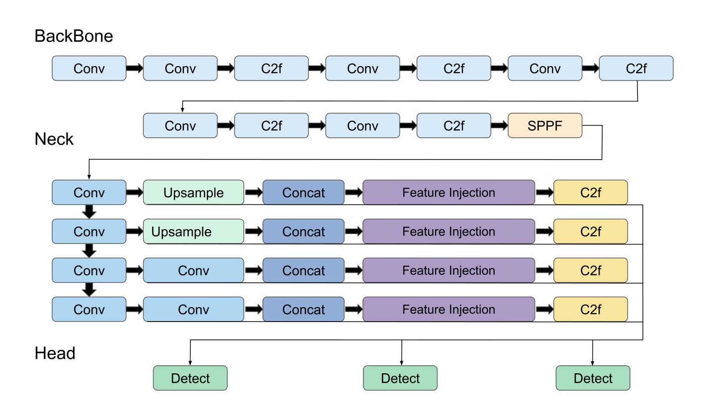
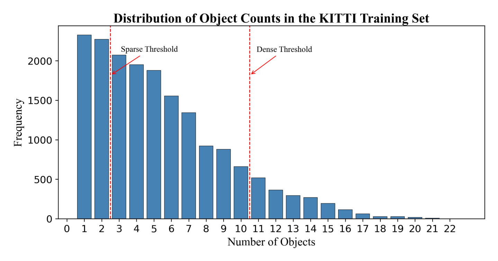
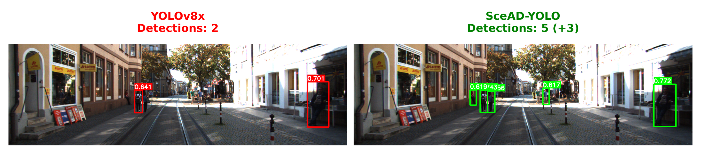
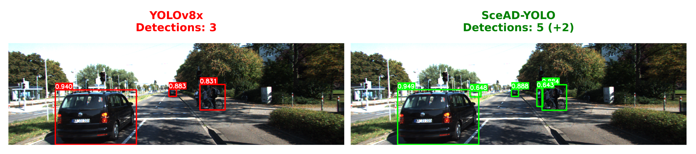
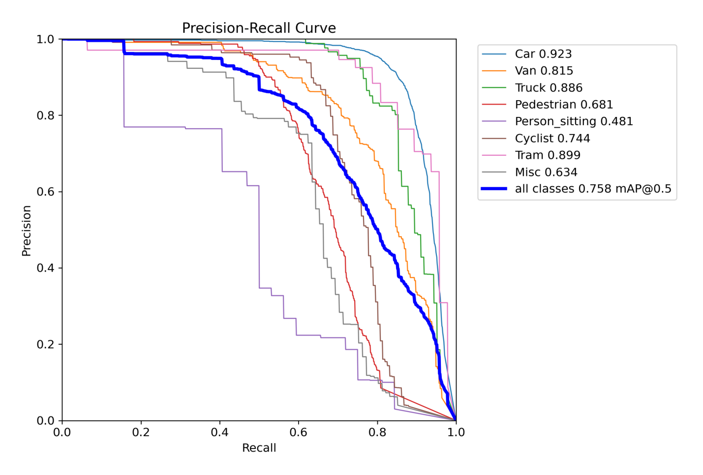
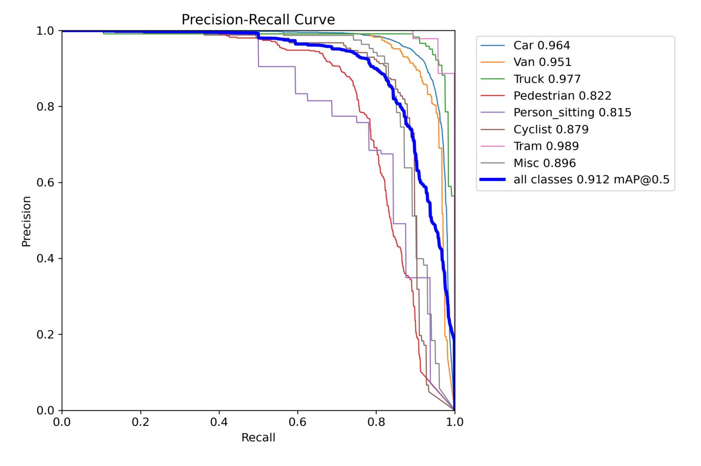
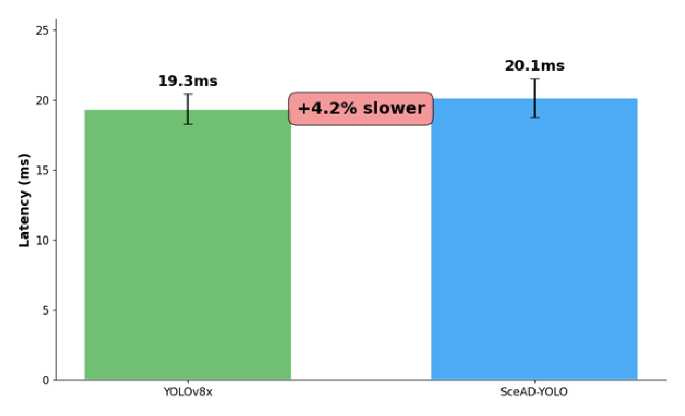

# SceAD-YOLO

This repository accompanies the paper **"강인한 자율주행을 위한 상황 적응형 YOLO: 문맥 인지 객체 탐지" (Scenario-Adaptive YOLO: Context-Aware Object Detection for Robust Autonomous Driving)**, presented at the 2026 Spring Conference of the Korea Next-Generation Computing Society (한국차세대컴퓨팅학회 춘계학술대회), May 2026, where it received the **우수상 (Excellence Award)** for an outstanding poster paper.

**Authors:** Seongwook Lee, Seungyeong Kim, Jaemin Oh, Hyeonjoon Moon — Sejong University
**Paper number:** 제 26-06호 · **Award date:** May 8, 2026 · **Awarding body:** (사)한국차세대컴퓨팅학회

## Overview

Object detectors are usually trained on aggregated driving data with a single objective, even though driving scenes differ sharply: crowded intersections, sparse roads, pedestrian-heavy streets, and semantically diverse frames fail in different ways. SceAD-YOLO makes the scene explicit. Each frame is labeled with a quantifiable driving scenario, and that label is injected into a YOLOv8x detector as a trainable embedding at the neck feature maps while also re-weighting the detection loss. The detector and its inference path stay otherwise unchanged, so the accuracy gain costs 0.8 ms per frame.

## Key Contributions

- **Quantifiable scenario definitions.** Every frame is assigned one of four scenarios — `Dense`, `Sparse`, `Pedestrian`, `Diverse` — from annotation-derived counts, with priority `Pedestrian > Dense > Diverse > Sparse` when several criteria hold. The object-count thresholds are taken from the KITTI training distribution (Fig. 2).
- **Scenario-aware feature injection.** The scenario label becomes a 32-d trainable embedding, linearly mapped to the channel dimension and added to fused multi-scale features after each `Concat` in the YOLOv8 Neck, before the following `C2f` blocks.
- **Scenario-sensitive loss adjustment.** Classification, objectness, and localization terms are weighted per scenario, so that e.g. pedestrian recall is prioritized in `Pedestrian` scenes.
- **Measured cost of context.** A 15.4 pp mAP@0.5 gain over the YOLOv8x baseline on a scenario-restructured KITTI dataset for +4.2% inference latency.

## Scenario Classification

| Scenario | Primary criterion | Threshold |
| --- | --- | --- |
| Dense | Object count per frame | > 10 |
| Sparse | Object count per frame | < 3 |
| Pedestrian | Pedestrian object ratio | > 50% |
| Diverse | Unique object categories per frame | ≥ 4 |

Labels are produced offline from ground-truth annotations (an oracle setting adopted to isolate the effect of the architectural changes; online classification is left to future work).

## Results (from the paper)

**Overall detection performance on the restructured KITTI test set** (mAP@0.5, IoU 0.5):

| Model | mAP@0.5 (%) |
| --- | --- |
| YOLOv8x (baseline) | 75.8 |
| **SceAD-YOLO (ours)** | **91.2** |
| Absolute improvement | +15.4 pp |
| Relative improvement | +20.3% |

**Ablation study** — each component contributes incrementally:

| Model configuration | Feature injection | Loss adjustment | mAP@0.5 (%) |
| --- | :---: | :---: | --- |
| YOLOv8x (baseline) | — | — | 75.8 |
| SceAD-YOLO (w/o Loss Adj.) | ✓ | — | 84.5 |
| SceAD-YOLO | ✓ | ✓ | 91.2 |

**Per-class average precision** (values reported in the legends of the PR curves, Fig. 4):

| Class | YOLOv8x AP@0.5 | SceAD-YOLO AP@0.5 | Δ |
| --- | --- | --- | --- |
| Car | 0.923 | 0.964 | +0.041 |
| Van | 0.815 | 0.951 | +0.136 |
| Truck | 0.886 | 0.977 | +0.091 |
| Pedestrian | 0.681 | 0.822 | +0.141 |
| Person_sitting | 0.481 | 0.815 | +0.334 |
| Cyclist | 0.744 | 0.879 | +0.135 |
| Tram | 0.899 | 0.989 | +0.090 |
| Misc | 0.634 | 0.896 | +0.262 |
| **All classes** | **0.758** | **0.912** | **+0.154** |

**Inference latency** (average per frame): 19.3 ms for YOLOv8x vs. 20.1 ms for SceAD-YOLO — +0.8 ms, a 4.2% overhead.

**Setup.** KITTI, relabeled by scenario and split per scenario into roughly 70%/20%/10% for training, validation, and test. YOLOv8x with COCO pre-trained weights, PyTorch, AdamW (lr 0.01, β₁ 0.9, β₂ 0.999, weight decay 5e-4), batch size 16, 20 epochs, cosine schedule, mosaic disabled for the final 10 epochs.

## Figures from the Paper

**Figure 1 — Overall architecture.** Scenario embeddings are injected after the `Concat` operations in the Neck, preceding the `C2f` layers at three scales.

**Figure 2 — Object-count distribution in the KITTI training set.** The red dashed lines mark the thresholds that define the `Sparse` (< 3 objects) and `Dense` (> 10 objects) scenarios.

**Figure 3 — Qualitative comparison** (YOLOv8x baseline left, SceAD-YOLO right).

(a) A challenging urban scene belonging to the `Pedestrian` and `Diverse` scenarios. SceAD-YOLO detects pedestrians missed by the baseline.

(b) A scene with inter-object occlusion. The proposed model finds distant and partially obscured pedestrians that the baseline misses.

**Figure 4 — Precision-Recall curves** on the restructured KITTI test set.

(a) YOLOv8x baseline (mAP@0.5 = 75.8%).

(b) SceAD-YOLO (mAP@0.5 = 91.2%).

**Figure 5 — Inference latency comparison.** A significant accuracy gain for a minor 4.2% increase in latency.

## Paper and Award Artifacts

Full artifacts are under [`portfolio/`](portfolio/README.md):

- [Korean conference paper (PDF)](portfolio/papers/scead-yolo-paper-ko.pdf)
- [Conference poster (PDF)](portfolio/posters/scead-yolo-poster.pdf)
- [Award certificate — 우수상, 제 26-06호 (PDF)](portfolio/awards/sejong-excellence-award.pdf)
